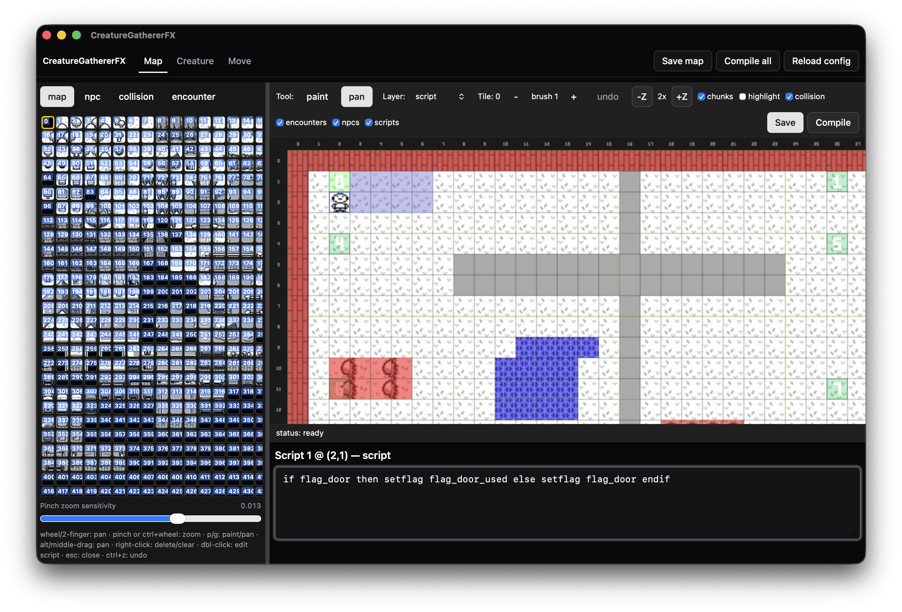

# CreatureGathererTools

Authoring toolchain for **CreatureGathererFX**, a GBA creature-battler (pixel arthouse game). Turns human-authored game content into engine-ready artifacts: C headers and a **PokerVM** binary bytecode blob (run by a VM from SPI-flash).



## Features

- **Desktop UI** (Tauri 2 + React + Tailwind v4 + shadcn/ui) with three tabbed editors — Map, Creature, Move — that stay mounted to preserve per-editor state.
- **Map editor**: tile painting, layers, palette with resizable sprite sheet + pinch zoom, pan/paint tools, gesture pan/pinch zoom, double-click script edit.
- **Script pane**: live parse feedback (line/col errors, opcode preview) for the in-game script language (branches, counters, locations, commands).
- **Deterministic compilation** of maps, creatures, and moves into C headers + binary blobs, byte-parity with the reference Go implementation (integration tests assert zero discrepancy).
- **Tiled interoperability**: import/export maps via Tiled-style JSON (`crates/core/src/tiled.rs`).
- **Offline, single-machine workflow**: no network services; game data lives in a sibling `CreatureGathererFX` checkout wired in via `src-tauri/creature-tools.json`.

## Architecture

Three layers, dependency direction `ui → src-tauri → crates/core`:

### 1. React frontend — `ui/`

React 18 + TypeScript + Vite + Tailwind v4 + shadcn/ui (Radix) primitives. Talks to the backend exclusively via `@tauri-apps/api` `invoke()` — never touches the filesystem directly. Pure logic extracted for unit testing: `state.ts`, `geometry.ts`, `tileset.ts`, `lib/validation.ts`.

### 2. Tauri 2 shell — `src-tauri/` (crate `cgfx-app`, lib `cgfx_app_lib`)

Thin IPC layer over the core library. Every `#[tauri::command]` returns a serializable value or `Result<_, String>` — no panics across IPC, no `clap` here. Commands wrap `creaturevm` (cgfx-core): `load_config`/`save_config`, `load_map`/`save_map`, `load_creatures`/`save_creatures`, `load_moves`/`save_moves`, `compile_map`, `compile_all`, `parse_script`, `read_file_bytes`, `tiled_import_path`, `tiled_export_path`.

### 3. Rust core — `crates/core/` (lib `creaturevm`, bin `pokervm-rust`)

CLI + reusable library. Pipeline stages (see `src/main.rs`):

1. **Parse** (`parser/`) — load project JSON (creatures, moves, map).
2. **Process** (`processor/`) — lex/parse/assemble the script language to an AST (`ast.rs`) then to bytecode; `blob.rs` packs the binary.
3. **Write** (`writer/`) — emit C headers (`c.rs`) and the binary artifact (`bin.rs`, 24-bit little-endian via `u24.rs`). Binary layout: text block (offset table + ASCII blob) + bytecode block, padded to 256-byte alignment.

Supporting modules: `builder.rs` (map/creature/moves builders incl. worldmap chunking), `store.rs`, `config.rs`, `tiled.rs`, `model.rs` (domain types: `Creature`, `GameMap`, `Move`). See `crates/core/docs/` for `binary_format.md` and `worldmap.md`.

## Repo Layout

```
crates/core/        Rust library + CLI (cgfx-core / creaturevm)
crates/core/tests/  Integration tests incl. Go-parity suite
src-tauri/          Tauri 2 shell (IPC commands)
ui/                 React frontend
screenshots/        App screenshots
```

## Build & Test

```bash
# Rust core + shell
cargo build                                   # workspace: crates/core + src-tauri
cargo test                                    # unit + integration tests
cargo run -p cgfx-core -- <input.json> <output_dir>   # CLI only, no UI

# React frontend (from ui/)
npm install
npm run dev                                   # vite dev server (UI only)
npm test                                      # vitest run
npm run build                                 # typecheck (tsc) + vite build

# Full desktop app
npm run tauri dev                             # requires Rust toolchain
```

Test notes:

- Frontend tests are **vitest + Testing Library**, co-located as `*.test.ts(x)` next to the source they cover.
- Backend tests live in `crates/core/tests/`; integration tests assert parity with the Go reference implementation.
- Rate-limiting/asset paths in `creature-tools.json` are machine-specific — do not commit changes to it.

## Task Tracking

Issues are tracked with **bd (beads)**:

```bash
bd ready              # Find available work
bd show <id>          # View issue details
bd close <id>         # Complete work
```

## Conventions & Patterns

- **Rust**: edition 2024, `anyhow` for error context, `serde` derive for models, errors cross IPC only as strings. Mixed-case module names (e.g. `tiled.rs`) are intentional.
- **TypeScript**: strict; UI components never do I/O directly — go through `invoke`. Keep geometry/canvas math in pure modules so it can be unit-tested without a DOM.
- **Tests are permanent** — co-located with source, never in temp directories, never deleted.
